# Build2Cloud

### Automated Application Deployment and Monitoring System

EasyDeploy is a learning-focused **DevSecOps project** that automates the process of building, securing, deploying, and monitoring a containerized application on AWS.

The project uses **Terraform** to provision cloud infrastructure, **Ansible** to configure the application server, and **Jenkins** to automate the CI/CD pipeline. The application is packaged with **Docker**, scanned with **Trivy**, stored in **Amazon ECR**, and deployed to an **Amazon EC2** instance. **Prometheus** and **Grafana** provide infrastructure and application monitoring.

In addition to the reference project's core workflow, EasyDeploy is planned to include deployment health checks, automatic rollback to the previous working image when a release fails, restricted infrastructure access, and deployment history.

> **Project status:** This README describes the intended design and implementation plan. Features should be marked as completed only after they have been implemented and tested.

---

## Table of Contents

1. Project Overview
2. Key Features
3. Technology Stack
4. System Architecture
5. CI/CD Workflow
6. How the Main Tools Work Together
7. Repository Structure
8. Getting Started
9. Configuration
10. Security Considerations
11. Deployment Verification and Rollback
12. Monitoring
13. Implementation Roadmap
14. Future Improvements
15. References

---

## 1. Project Overview

In a manual deployment process, a developer may need to build an application, prepare a server, copy files, configure dependencies, start the application, and check whether it is working. Repeating these steps for every code change takes time and can introduce configuration mistakes.

EasyDeploy aims to automate this workflow.

When a developer pushes an approved code change to GitHub, Jenkins starts the pipeline. The pipeline tests the application, builds a Docker image, scans it for vulnerabilities, and publishes an approved image to Amazon ECR. Ansible then deploys the selected image to the EC2 application server.

A health check verifies the new release. If the release fails its health check, the deployment process is designed to restore the previous working image.

Terraform is used separately to create and update AWS infrastructure. It does not need to recreate infrastructure for every application code change.

## 2. Key Features

### Core DevOps Features

- **Infrastructure as Code:** Provision AWS resources using reusable Terraform configurations.
- **Configuration Automation:** Configure EC2 servers using Ansible playbooks and roles.
- **Continuous Integration:** Trigger Jenkins builds from GitHub changes.
- **Containerization:** Package the Flask application and its dependencies using Docker.
- **Image Registry:** Store versioned application images in Amazon Elastic Container Registry (ECR).
- **Deployment Automation:** Use Ansible to pull and deploy the selected image to EC2.
- **Security Scanning:** Scan container images with Trivy before deployment.
- **Monitoring:** Collect metrics with Prometheus and display dashboards using Grafana.

### Unique Features and Enhancements

- **Enforced Security Gate:** Configure Trivy so that vulnerabilities above the selected severity threshold cause the pipeline to fail.
- **Deployment Health Check:** Check an application's health endpoint after deploying a new image.
- **Automatic Rollback:** Restore the previous known-good image if the new deployment does not become healthy within the configured retry period.
- **Restricted Infrastructure Access:** Limit SSH access to approved IP addresses and use least-privilege IAM permissions.
- **Reverse Proxy:** Use Nginx as the public entry point and forward requests to the application container.
- **Deployment History:** Record the deployed image tag, build number, timestamp, and deployment result.
- **Application-Level Monitoring:** Track request counts, response times, and application errors in addition to server metrics.

## 3. Technology Stack

| Technology | Purpose |
|---|---|
| Python / Flask | Sample web application and health endpoint |
| Git / GitHub | Source-code version control |
| Jenkins | CI/CD orchestration |
| Docker | Application containerization |
| Terraform | AWS infrastructure provisioning |
| Ansible | Server configuration and application deployment |
| AWS EC2 | Hosts the application container |
| Amazon ECR | Stores versioned Docker images |
| Trivy | Container image vulnerability scanning |
| Ansible Vault / Jenkins Credentials | Protects deployment secrets |
| Nginx | Reverse proxy |
| Prometheus | Metrics collection |
| Grafana | Metrics dashboards and visualization |

## 4. System Architecture

The following diagram represents the proposed target architecture.

Terraform provisions the AWS infrastructure, Ansible configures and deploys to the application server, and Jenkins manages the CI/CD pipeline.

### Architecture Flowchart

```mermaid
flowchart TB
    subgraph SOURCE["🚀 01 · Launchpad"]
        DEV@{ shape: person, label: "Developer" }
        GIT@{ shape: docs, label: "GitHub Repository" }
        DEV -->|Push code| GIT
    end

    subgraph CI["🛠️ 02 · Build & Security Forge"]
        JENKINS["Jenkins CI/CD Pipeline"]
        TEST["🧪 Run Automated Tests"]
        BUILD["📦 Build Docker Image"]
        SCAN{"🛡️ Trivy Scan<br/>Passes security policy?"}
        PUSH["Push Versioned Image"]
        FAIL(["⛔ Pipeline Stopped"])

        JENKINS --> TEST --> BUILD --> SCAN
        SCAN -->|Pass| PUSH
        SCAN -->|Fail| FAIL
    end

    GIT -->|Webhook| JENKINS
    PUSH --> ECR[("📦 Amazon ECR<br/>Versioned Images")]

    subgraph AWS["☁️ 03 · AWS Deployment Deck"]
        TF{{"Terraform"}}
        INFRA["EC2 / IAM / Security Groups / Network"]
        ANSIBLE[["Ansible Deployment Playbook"]]

        subgraph RUNTIME["Application Runtime"]
            APPHOST["🖥️ EC2 Application Server"]
            NGINX["Nginx Reverse Proxy"]
            APP["Flask Application Container"]
            APPHOST --> NGINX --> APP
        end

        TF -.->|Provision| INFRA
        INFRA --> APPHOST
        ANSIBLE -->|Configure and deploy| APPHOST
    end

    ECR ==>|Pull approved image| APPHOST
    JENKINS -.->|Execute deployment playbook| ANSIBLE

    subgraph VERIFY["🩺 04 · Flight Check & Recovery"]
        HEALTH{"Health Check<br/>Application healthy?"}
        SUCCESS(["✅ Deployment Successful"])
        ROLLBACK["↩️ Restore Previous Image"]

        HEALTH -->|Healthy| SUCCESS
        HEALTH -->|Unhealthy| ROLLBACK
    end

    APP --> HEALTH
    ROLLBACK -->|Redeploy previous version| APPHOST

    subgraph OBSERVE["📡 05 · Mission Control"]
        METRICS["Node Exporter / Application Metrics"]
        PROM[("Prometheus")]
        GRAFANA@{ shape: display, label: "Grafana Dashboards" }
        METRICS -.-> PROM -.-> GRAFANA
    end

    APPHOST -.->|Telemetry| METRICS
```

## 5. CI/CD Workflow

The intended application release process works as follows:

1. A developer commits and pushes code to GitHub.
2. A GitHub webhook notifies Jenkins that a change is available.
3. Jenkins checks out the repository and prepares the build environment.
4. Jenkins executes automated application tests.
5. Jenkins builds a Docker image and tags it with a unique identifier, such as the Jenkins build number or Git commit SHA.
6. Trivy scans the image. If the configured security policy is not met, the pipeline stops.
7. Jenkins authenticates to Amazon ECR using an approved AWS identity and pushes the image.
8. Jenkins starts the Ansible deployment playbook and passes the image tag to it.
9. Ansible connects to the EC2 host, pulls the selected image, and deploys the container.
10. The deployment process checks the application's health endpoint.
11. If the new release is healthy, the deployment is recorded as successful.
12. If the release fails, the process attempts to restore the previous known-good image and records the failure.
13. Prometheus collects configured metrics and Grafana displays dashboards.

### CI/CD Sequence Diagram

```mermaid
sequenceDiagram
    autonumber
    actor Developer
    participant GitHub
    participant Jenkins
    participant Trivy as Trivy<br/>Security Scanner
    participant ECR as Amazon ECR<br/>Image Registry
    participant Ansible as Ansible<br/>Deployment
    participant EC2 as EC2 / Docker
    participant App as Flask App

    Note over Developer,Jenkins: 1. Build
    Developer->>GitHub: Push code change
    GitHub-->>Jenkins: Trigger pipeline via webhook
    Jenkins->>GitHub: Check out source code
    Jenkins->>Jenkins: Run tests and build Docker image

    Note over Jenkins,Trivy: 2. Security check
    Jenkins->>Trivy: Scan Docker image

    alt Security policy passes
        Trivy-->>Jenkins: Scan passed

        Note over Jenkins,ECR: 3. Publish image
        Jenkins->>ECR: Push image with version tag
        ECR-->>Jenkins: Image available

        Note over Ansible,App: 4. Deploy and verify
        Jenkins->>Ansible: Deploy image with version tag
        Ansible->>EC2: Pull image and deploy container
        EC2->>App: Start application
        Ansible->>App: Check health endpoint

        alt Health check passes
            App-->>Ansible: Healthy
            Ansible-->>Jenkins: Deployment successful
        else Health check fails
            App-->>Ansible: Unhealthy
            Ansible->>EC2: Restore previous image
            Ansible-->>Jenkins: Deployment failed&#59; rollback attempted
        end

    else Security policy fails
        Trivy-->>Jenkins: Vulnerability threshold exceeded
        Jenkins-->>Developer: Pipeline failed&#59; deployment blocked
    end
```



## 6. How the Main Tools Work Together

### Terraform and Ansible

Terraform creates or updates infrastructure such as EC2 instances, IAM permissions, security groups, and ECR repositories.

Ansible configures the operating system, installs the required dependencies, and deploys the application.

Terraform manages cloud infrastructure, whereas Ansible manages server configuration and deployment tasks.

### Jenkins and Docker

Jenkins automates the build and test stages. Docker packages the application and its runtime dependencies into an image.

Each release uses an identifiable image tag so that a previous version can be selected for rollback.

### Trivy and Amazon ECR

Trivy scans the Docker image against the configured security policy.

Only images that pass the policy should proceed to publishing and deployment.

Amazon ECR stores the approved, versioned images.

### Ansible and EC2

Ansible connects to the EC2 application host and performs deployment tasks.

It pulls the image tag supplied by Jenkins, updates the running container, and performs the configured health check.

### Prometheus and Grafana

Prometheus collects configured metrics from the application host and instrumented application endpoints.

Grafana uses Prometheus as a data source to display monitoring dashboards.

## 7. Repository Structure

The proposed repository structure is:

```text
EasyDeploy/
│
├── app/
│   ├── app.py
│   ├── requirements.txt
│   └── tests/
│
├── docker/
│   ├── Dockerfile
│   └── nginx/
│       └── default.conf
│
├── terraform/
│   ├── main.tf
│   ├── variables.tf
│   ├── outputs.tf
│   └── modules/
│
├── ansible/
│   ├── inventory/
│   ├── playbooks/
│   ├── roles/
│   └── group_vars/
│
├── jenkins/
│   └── Jenkinsfile
│
├── monitoring/
│   ├── prometheus/
│   └── grafana/
│
├── scripts/
│   ├── health-check.sh
│   └── rollback.sh
│
├── docs/
│
├── .gitignore
└── README.md
```

The structure may change as implementation progresses.

## 8. Getting Started

### Prerequisites

Install or prepare the following tools:

- Git
- Docker Engine and Docker Compose plugin
- Python 3 and pip
- Terraform CLI
- Ansible
- Jenkins with the required pipeline and credentials configuration
- AWS account and AWS CLI
- An AWS IAM identity with the required deployment permissions

### Step 1: Clone the Repository

```bash
git clone <YOUR_GITHUB_REPOSITORY_URL>

cd EasyDeploy
```

Replace the placeholder with your repository URL.

### Step 2: Run the Flask Application Locally

After creating the Flask application and its dependencies:

```bash
cd app

python3 -m venv .venv

source .venv/bin/activate

pip install -r requirements.txt

python app.py
```

Add and test an application health endpoint such as `/health` before using it for deployment verification.

### Step 3: Build and Run Docker Image

After creating the Dockerfile:

```bash
docker build -t easydeploy-app:local -f docker/Dockerfile .

docker run --rm -p 5000:5000 easydeploy-app:local
```

Adjust the build context, Dockerfile location, and port mapping according to the final configuration.

### Step 4: Provision AWS Infrastructure

Configure AWS credentials using an appropriate IAM identity.

Then execute:

```bash
cd terraform

terraform init

terraform fmt -check

terraform validate

terraform plan

terraform apply
```

Review the planned resources and estimated AWS charges before approving `terraform apply`.

### Step 5: Configure the Server Using Ansible

Update the Ansible inventory with the EC2 host, SSH user, and approved SSH key reference.

Check connectivity:

```bash
cd ../ansible

ansible-inventory -i inventory/hosts.ini --list

ansible all -i inventory/hosts.ini -m ping
```

Perform a dry run:

```bash
ansible-playbook -i inventory/hosts.ini playbooks/configure-server.yml --check
```

Review the output before applying the playbook without `--check`.

### Step 6: Configure Jenkins Pipeline

Create a Jenkins Pipeline job pointing to the repository's Jenkinsfile.

Configure:

- GitHub webhook.
- Jenkins credentials.
- AWS authentication.
- Docker build and testing stages.
- Trivy security scanning.
- ECR image publishing.
- Ansible deployment.

Do not store passwords, access keys, or private keys directly inside the Jenkinsfile.

## 9. Configuration

Create environment-specific configuration using example files.

For example:

```env
AWS_REGION=<aws-region>

ECR_REPOSITORY=<ecr-repository-name>

APP_IMAGE_TAG=<unique-image-tag>

APP_PORT=<application-port>

HEALTHCHECK_URL=<application-health-url>
```

These are illustrative variable names. The actual names must match the final application and pipeline configuration.

Store sensitive values in Jenkins Credentials, Ansible Vault, or appropriate AWS identity mechanisms.

Commit only safe example files such as `.env.example`. Never commit actual environment files containing secrets, private keys, or cloud credentials.

## 10. Security Considerations

- Use least-privilege IAM policies.
- Prefer EC2 instance roles instead of storing long-lived AWS access keys on servers.
- Restrict SSH access to approved administrative IP addresses.
- Use AWS Systems Manager Session Manager where appropriate.
- Expose only the required network ports.
- Keep the Flask container port private behind Nginx where possible.
- Store sensitive information in Jenkins Credentials or Ansible Vault.
- Scan Docker images using Trivy before deployment.
- Configure security scans to return a non-zero exit code when the selected severity threshold is exceeded.
- Review Terraform plans before applying infrastructure changes.
- Keep passwords, tokens, and private keys out of logs and source code.

## 11. Deployment Verification and Automatic Rollback

One of the main improvements in EasyDeploy is automated deployment verification and recovery.

The planned deployment process keeps track of the currently running image tag before replacing the container.

After deployment, the application health endpoint is checked several times using a configured retry interval and timeout.

**Successful deployment:**

- The application responds successfully.
- The new image becomes the current version.
- The deployment is recorded as successful.

**Failed deployment:**

- The health check detects application failure.
- The deployment process attempts to restore the previous working image.
- The rollback result is recorded.
- Jenkins reports the deployment failure.

This functionality must be implemented and tested with both successful and deliberately failing deployments before it is considered complete.

## 12. Monitoring

EasyDeploy uses Prometheus and Grafana to monitor infrastructure and application health.

### Monitoring Components

| Component | Responsibility |
|---|---|
| Node Exporter | Collects server-level metrics |
| Prometheus | Scrapes and stores metrics |
| Grafana | Creates monitoring dashboards |
| Flask Metrics | Exposes application-level metrics |

### Metrics to Monitor

- CPU utilization.
- Memory utilization.
- Disk usage.
- Network traffic.
- Application request count.
- API response time.
- HTTP error count.
- Application availability.
- Container status.

These dashboards should help identify infrastructure problems, application failures, and deployment-related issues.

## 13. Implementation Roadmap

- [ ] Create Flask application and automated tests.
- [ ] Add an application health endpoint.
- [ ] Containerize application using Docker.
- [ ] Create AWS infrastructure using Terraform.
- [ ] Configure EC2 servers using Ansible.
- [ ] Integrate GitHub webhook with Jenkins.
- [ ] Implement Docker image build and ECR publishing.
- [ ] Integrate Trivy security scanning.
- [ ] Implement enforced security gates.
- [ ] Automate application deployment through Ansible.
- [ ] Implement deployment health checks.
- [ ] Implement automatic rollback.
- [ ] Configure Nginx reverse proxy.
- [ ] Configure Prometheus and Grafana.
- [ ] Add application-level monitoring.
- [ ] Implement deployment history.
- [ ] Test failure scenarios and recovery procedures.
- [ ] Prepare project documentation and architecture diagrams.

## 14. Future Improvements

Possible future extensions include:

- Blue-green deployment.
- Canary deployment.
- HTTPS with automated certificate renewal.
- Centralized log collection.
- Dependency and secret scanning.
- Infrastructure policy checks.
- Automated backup and disaster recovery.
- Kubernetes-based deployment.
- Helm and ArgoCD integration.

## 15. References

1. [Terraform Documentation](https://developer.hashicorp.com/terraform/docs)
2. [Ansible Documentation](https://docs.ansible.com/)
3. [Jenkins Documentation](https://www.jenkins.io/doc/)
4. [Docker Documentation](https://docs.docker.com/)
5. [Amazon EC2 Documentation](https://docs.aws.amazon.com/ec2/)
6. [Amazon ECR Documentation](https://docs.aws.amazon.com/ecr/)
7. [Trivy Documentation](https://trivy.dev/latest/docs/)
8. [Prometheus Documentation](https://prometheus.io/docs/)
9. [Grafana Documentation](https://grafana.com/docs/)
10. [Flask Documentation](https://flask.palletsprojects.com/)
11. [Nginx Documentation](https://nginx.org/en/docs/)

---

**Note:** EasyDeploy is an educational DevOps/DevSecOps implementation. Production use would require additional security reviews, resilience testing, capacity planning, backup and recovery validation, and operational controls.
